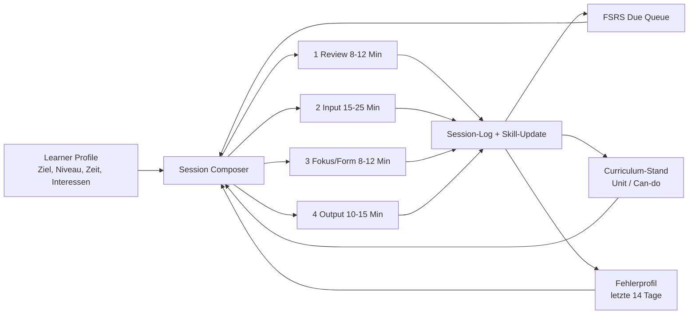
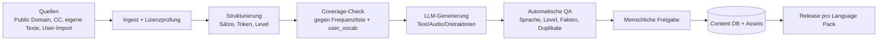

# Plan: Komplettumbau zu einer mehrsprachigen Lern-App

**Status:** Entwurf, noch keine Umsetzung
**Ziel:** Aus „Refresh Your English“ wird eine sprachunabhängige Lern-App, in der ein Nutzer Zielsprache, Ausgangsniveau und Ziel festlegt und einen wissenschaftlich fundierten Weg dorthin bekommt – zuerst für Italienisch A1 → B1/B2, ohne den funktionierenden Englisch-Teil zu verlieren.

---

## 1. Leitentscheidungen (Executive Summary)

1. **Nicht „Englisch-App mit Sprachschalter“, sondern eine Lern-Engine + Sprachpakete.** Die Engine (SRS, Session-Planung, Feedback, Fortschritt) ist sprachneutral. Alles Sprachspezifische (Vokabular, Grammatik-Syllabus, TTS/STT-Locale, Tokenisierung, Ausspracheregeln, CEFR-Deskriptoren, Seed-Inhalte) steckt in einem deklarativen **Language Pack**.
2. **Das Datenmodell wird von `english`/`german` entkoppelt.** Neue Struktur: `vocab_item` (Lemma in Zielsprache) + `vocab_sense` (Bedeutung in Muttersprache) + `user_vocab` (FSRS-Zustand pro Nutzer **und Zielsprache**).
3. **Der Lernpfad wird explizit.** Onboarding → Einstufungstest → Learner Profile → Curriculum (CEFR-Units) → täglicher Session-Plan. Der Nutzer sieht nicht mehr nur Module, sondern „was heute dran ist“.
4. **Didaktisch wird das bestehende Konzept um die fehlenden Säulen erweitert:** massiver comprehensible Input, Sentence Mining, pushed output, Shadowing/Aussprache, extensive Reading – plus FSRS statt SM-2.
5. **Umbau als Strangler, nicht Big Bang.** Der bestehende Englisch-Modus bleibt über Feature-Flags lauffähig, während die neue Engine daneben wächst. Ein harter Cut-over erfolgt erst, wenn der neue Pfad für Englisch und Italienisch nachweislich besser ist.
6. **Frontend und Backend werden sprachneutral, aber nicht neu erfunden.** React/Vite/Express bleiben. Neu kommen: i18n, Language Context, API v2, Migrations-Layer, Prompt-Registry, Content-Pipeline.

---

## 2. Ist-Analyse: Warum das heutige Konzept für Italienisch nicht trägt

### 2.1 Was heute existiert

| Bereich | Heute | Dateien |
|---|---|---|
| Einstieg | Modul-Grid, kein Onboarding, keine Sprachwahl | [src/App.jsx](./src/App.jsx) |
| Übersetzen | Deutsch → Englisch, LLM-Bewertung, Level frei wählbar | [src/components/TranslationModule.jsx](./src/components/TranslationModule.jsx) |
| Action-Modus | Vokabel-Quiz mit Countdown | [src/components/ActionModule.jsx](./src/components/ActionModule.jsx) |
| Dialog | KI-Konversation auf Englisch, Feedback auf Deutsch | [src/components/DialogModule.jsx](./src/components/DialogModule.jsx) |
| Flashcards | SM-2-ähnlich (`ease_factor`, `interval_days`, `repetitions`) | [src/components/VocabularyTrainer.jsx](./src/components/VocabularyTrainer.jsx), [backend/src/models/database.js](./backend/src/models/database.js) |
| Bibliothek | Suche/Verwaltung der Vokabeln | [src/components/VocabularyLibrary.jsx](./src/components/VocabularyLibrary.jsx) |
| LLM | Prompts hart auf Englisch + Feedback Deutsch; Logik doppelt in Frontend und Backend | [src/services/llmService.js](./src/services/llmService.js), [backend/src/routes/llmRoutes.js](./backend/src/routes/llmRoutes.js) |
| TTS/STT | Browser-API, nur `en`/`de` | [src/services/ttsService.js](./src/services/ttsService.js), [src/services/sttService.js](./src/services/sttService.js) |
| Daten | `vocabulary(english, german, level)`, Fortschritt daran gekoppelt | [backend/src/models/database.js](./backend/src/models/database.js) |

### 2.2 Harte Blocker

- **Zweisprachige Spalten:** `english`/`german` sind im Schema, in API-Parametern, Komponenten, Prompts und Fallbacks verdrahtet. Italienisch ist damit nicht abbildbar, ohne überall Sonderfälle zu bauen.
- **Kein Nutzermodell für Sprachen:** Es gibt keinen Ort für „lernt Italienisch, Muttersprache Deutsch, Ziel B1, 30 Min/Tag, Interesse Reisen“.
- **Keine Einstufung:** Level ist ein freier Dropdown (`B2` Default). Ein A1-Lerner bekommt dieselben Aufgaben wie ein B2-Lerner.
- **Kein Curriculum:** Aufgaben werden zufällig generiert. Es gibt keine Progression, keine Unit-Abschlüsse, keine Can-do-Checks.
- **Kein Input, kein Hören, kein Lesen, kein Sprechen im Lernfluss:** Genau die Säulen, die bei einem stagnierenden A1-Lerner den Unterschied machen, fehlen.
- **Prompt-Kontamination:** Prompts mischen Ziel- und Muttersprache („deutscher Satz“, „englische Übersetzung“). Bei Italienisch würde das sofort falsche oder gemischte Ausgaben erzeugen.
- **Fehlende Qualitätssicherung:** LLM-Ausgaben werden kaum strukturell validiert; Fallbacks sind englisch/deutsch hartkodiert.
- **Doppelte LLM-Logik:** Frontend- und Backend-Prompts driften auseinander; Bewertung und Generierung sind nicht testbar.
- **FSRS/SM-2:** Das aktuelle Scheduling ist einfach, kennt keine Stabilität/Difficulty und keine Lernphasen; es optimiert nicht auf Behaltenswahrscheinlichkeit.

### 2.3 Was bleibt

- Die visuelle Sprache (Glass Cards, Tailwind) und die PWA-Basis funktionieren.
- Der Action-Modus als **Review-Spiel** ist ein gutes Intervall-Format.
- Dialog- und Übersetzungsmodul sind gute **Output-Formate**, wenn sie sprachneutral werden.
- Auth, Gamification, Logging und Deployment sind wiederverwendbar.

---

## 3. Didaktisches Fundament

Die App soll nicht „mehr Features“ stapeln, sondern den Lernprozess steuern. Jede Funktion wird an eine der folgenden Evidenzlinien gebunden.

### 3.1 Prinzipien

| # | Prinzip | Evidenz / Referenz | Konsequenz für die App |
|---|---|---|---|
| P1 | **Comprehensible Input** (i+1, hohe Menge) | Krashen; umfangreiche L2-Forschung | Reader/Listening mit 95–98 % bekannter Wörter, Audio, Glossar on demand |
| P2 | **Retrieval Practice + Spacing** | Testing-Effekt, FSRS | Jede Vokabel/Struktur wird abgefragt, nicht nur gezeigt; FSRS-Scheduler |
| P3 | **Pushed Output** | Swain | Schreiben, Übersetzen, Sprechen mit echten Aufgaben, nicht nur Multiple Choice |
| P4 | **Corrective Feedback + Focus on Form** | Lyster & Ranta; Meta-Analysen zu Korrektur | Fehler werden kategorisiert, erklärt und in spätere Sessions eingespeist |
| P5 | **Sentence Mining / Chunks** | Formulaic language, Collocations | Neue Wörter immer mit Beispielsatz + Audio + Kontext, nie isoliert |
| P6 | **Frequency-driven Vocabulary** | Nation; Zipf-Verteilung | Erste 1.000–2.000 Lemmata zuerst; `frequency_rank` steuert Curriculum |
| P7 | **Shadowing & Aussprache** | Arguelles; High-Variability Phonetic Training | Nachsprechen mit Originalaudio, gezielte Minimalpaare (z. B. `pala`/`palla`) |
| P8 | **Interleaving & desirable difficulty** | Lernforschung | Sessions mischen Fertigkeiten; keine Blockwiederholung derselben Karte |
| P9 | **Autonomie + Zielbindung** | Selbstbestimmungstheorie, Implementation Intentions | Nutzer wählt Ziel, Zeitbudget, Themen; App schlägt konkreten Tagesplan vor |
| P10 | **Messbarkeit** | CEFR Can-do | Einstufung,Unit-Checks, Exit-Tests, Skill-Radar |

### 3.2 Konsequenz: Der Tages-Loop

Nicht fünf gleichrangige Module, sondern ein **Session Composer**, der aus dem Learner Profile und den fälligen Reviews einen Tagesplan baut.



Standard-Session (30 Min): 10 Min Review, 12 Min Input/Reading, 8 Min Fokus, 10 Min Output. Bei 60 Min werden Input und Output gestreckt, nicht die Reviews verdoppelt.

### 3.3 Was das für Italienisch bedeutet

Der heutige Modus „Satz auf Deutsch → Englisch übersetzen“ funktioniert für einen fortgeschrittenen Englisch-Lerner, weil Grammatik und Lexik bereits stehen und nur Feinschliff trainiert wird. Für Italienisch A1 fehlen:

- **Lautsystem und Orthographie** (geminate Konsonanten, `gli`, `gn`, offene/geschlossene Vokale),
- **Grundgrammatik in sinnvoller Reihenfolge** (Artikel, Genus/Numerus, Präsens, Präpositionen, `passato prossimo`, `imperfetto`, Pronomen, `congiuntivo`),
- **Häufigkeitswortschatz mit Audio**,
- **sehr viel verständlicher Input** auf genau dem passenden Niveau,
- **Sprechgelegenheit mit korrigierendem Feedback**.

Deshalb ist der Italienisch-Pfad **input- und curriculum-getrieben**, nicht übersetzungsgetrieben.

---

## 4. Produktkonzept

### 4.1 Onboarding (First Run, ca. 3–4 Minuten)

1. **Zielsprache** (Italienisch, Englisch, später weitere) – aus Language Packs.
2. **Muttersprache / Erklärungssprache** (Default Deutsch, änderbar).
3. **Ziel:** `Reisen`, `Alltag`, `Arbeit`, `Studium`, `Prüfung/CILS`, `Familie/Partner`.
4. **Zielniveau:** A2, B1, B2, C1 – mit „wo will ich hin?“-Formulierung.
5. **Zeithorizont:** kein Datum / 3 / 6 / 12 Monate / flexibel.
6. **Zeitbudget:** 15 / 30 / 45 / 60+ Min pro Tag.
7. **Interessen:** 3–5 Themen (Kochen, Fußball, Design, Geschichte, Musik …) – steuern Input-Texte.
8. **Einstufung:** „Ich fange neu an“ **oder** adaptiver Test (siehe 4.2).
9. **Plan-Vorschau:** „In 9–10 Monaten bei 30 Min/Tag auf B1; erste Woche: …“ mit ehrlicher Spanne.

Alles wird in `user_language` gespeichert. Ein Nutzer kann mehrere Zielsprachen parallel haben (Umschalter im Header), jede mit eigenem Fortschritt.

### 4.2 Einstufungstest (Placement)

- **Adaptiv, 12–20 Minuten**, je Skill getrennt: Lesen, Hören, Grammatik/Wortschatz, Schreiben, Sprechen (Sprechen optional, sonst Selbsteinschätzung mit Audio-Beispielen).
- **Item-Typen:** Lücken, Auswahl, Kurzübersetzung, Satz-Umformung, kurzes Leseverstehen, Hörverstehen, 2 freie Produktionen.
- **Algorithmus:** ELO/Rasch-light pro Skill; Abbruch bei Konfidenz; keine Bestrafung für Raten.
- **Ergebnis:** CEFR-Schätzung pro Skill + Gesamt + Empfehlung für Start-Unit. Nutzer kann Start-Unit manuell überspringen.
- **Item-Bank:** pro Language Pack, versioniert, mit Schwierigkeit und Diskriminationsindex; nach jedem Lauf neu kalibriert.
- **Wiederverwendung:** alle 8–12 Wochen als Progress-Check (kurz, 5–8 Min).

### 4.3 Learner Profile / Skill Model

Pro `user_language`:

- Ziel-CEFR, Zieltyp, Deadline, Tagesbudget, Interessen.
- Skills 0–100 + CEFR-Band: `reading`, `listening`, `speaking`, `writing`, `grammar`, `vocabulary`.
- `known_words_estimate` (aus FSRS-Zuständen + Coverage-Tests).
- Fehlerprofil: Kategorien (Genus, Kongruenz, Präposition, Verbform, Wortstellung, Orthographie, Aussprache) mit Häufigkeit und letztem Auftreten.
- Motivationszustand: Streak, letzte Session, Abbruchrate.

Das Profil ist die Grundlage für Session Composer, Schwierigkeitsanpassung und Fortschrittsanzeige.

### 4.4 „Heute“-Screen (neuer Startbildschirm)

Ersetzt das Modul-Grid als Default, sobald ein Profil existiert.

- **Karte 1: Review** – fällige Karten, geschätzte Dauer, Start-Button.
- **Karte 2: Input** – heutiger Text/Episode mit Niveau, Thema, Dauer, Neu-Wörtern.
- **Karte 3: Fokus** – Grammatik-/Struktur-Einheit mit 5–8 Übungen.
- **Karte 4: Output** – Schreib- oder Sprechaufgabe, ggf. Dialog.
- **Fortschritt:** Wochenziel, Streak, Skill-Radar, „Was diese Woche neu gelernt“.
- **Freier Modus:** alle Module bleiben direkt erreichbar (für den Englisch-Power-User).

### 4.5 Module (neu sortiert)

| Modul | Aufgabe | Didaktische Säule | Bestehende Basis |
|---|---|---|---|
| **Heute** | Session-Plan + Fortschritt | P9 | neu |
| **Reader** | Leveltexte, Audio, klickbare Wörter, Übersetzung, Mining | P1, P5 | neu (Bibliothek als Basis) |
| **Listening** | Audio mit/ohne Transkript, Diktat, Detailfragen | P1 | neu |
| **Review** | FSRS-Karten (Erkennen, Produzieren, Satz, Audio) | P2, P8 | VocabularyTrainer + ActionModule |
| **Fokus** | Grammatik erklärt + Übungen + Mini-Test | P4 | neu |
| **Schreiben** | Übersetzung, Umformung, freie Prompts, Feedback | P3, P4 | TranslationModule |
| **Sprechen** | Dialog, Shadowing, Aussprache-Feedback | P3, P7 | DialogModule + neue Teile |
| **Bibliothek** | Vokabeln, Sätze, Quellen, Suche, Import | P5 | VocabularyLibrary |
| **Fortschritt** | Skills, CEFR, Fehlerprofil, Can-do-Checks | P10 | StatsModule |

Der bisherige „Action-Modus“ wird kein eigenes Hauptmodul mehr, sondern ein **Review-Modus** (Speed-Runde) innerhalb von „Review“. Der Englisch-Power-User kann ihn weiter direkt starten.

### 4.6 Curriculum & CEFR

Aufbau: `Language Pack → Stage (A1/A2/B1/B2) → Unit → Lesson/Activity → Item`.

Jede Unit hat:

- **Can-do-Ziel** („Ich kann im Café bestellen und nach dem Preis fragen“).
- **Input:** 1–3 Texte/Episoden mit Zielvokabular und Grammatikfokus.
- **Vokabelset:** 15–30 Lemmata, frequenzbasiert, mit Audio und Beispielsatz.
- **Grammatikfokus:** 1 Punkt, kurze Erklärung in Muttersprache, 5–10 Übungen.
- **Output:** 1 Schreib-/Sprechaufgabe, die den Stoff verwendet.
- **Check:** Mini-Test (10 Items) + Selbsteinschätzung; bestanden → nächste Unit.
- **Wiederholung:** FSRS + wöchentlicher „Mixed Review“ aus alten Units.

Units sind **nicht** starr linear: Der Session Composer darf innerhalb eines Stages zwischen Units wechseln, wenn Fehlerprofil oder Interessen das nahelegen.

---

## 5. Der Italienisch-Pfad A1 → B1/B2

### 5.1 Realistische Zeitachse

| Abschnitt | Lernstunden | Bei 30 Min/Tag | Bei 60 Min/Tag | Exit-Kriterien |
|---|---|---|---|---|
| A0 → A1 | 80–120 | 4–6 Monate | 2–3 Monate | Grundphrasen, Präsens, Artikel, 500 Wörter |
| A1 → A2 | 150–200 | 7–9 Monate | 3–4 Monate | Alltagsgespräche, Vergangenheit, 1.200 Wörter |
| A2 → B1 | 250–300 | 10–14 Monate | 5–7 Monate | Meinungen, Pläne, 2.000–2.500 Wörter, `imperfetto`/`futuro` |
| B1 → B2 | 350–450 | 14–20 Monate | 7–10 Monate | Argumentieren, Nuancen, 3.500–4.000 Wörter, `congiuntivo` |

**Wichtig:** Diese Zahlen sind Lernzeit, nicht App-Zeit. Die App muss ehrlich kommunizieren, dass 30 Min/Tag für B2 etwa 2 Jahre bedeuten; B1 ist in 9–12 Monaten realistisch. Die aktuelle Erwartung „A1 → B2 schnell“ wird durch den Plan nicht verstärkt, sondern in Etappen mit Exit-Kriterien übersetzt.

### 5.2 Stoffplan (Auszug)

**A1:** Aussprache & Alphabet → Begrüßung → Artikel/Genus → Präsens `-are/-ere/-ire` → `essere/avere` → Zahlen/Zeit → Präpositionen + artikulierte Präpositionen → Café/Einkaufen → Familie → `passato prossimo` (erste Formen).
**A2:** Reflexive Verben → direkte/indirekte Pronomen → `imperfetto` vs. `passato prossimo` → `futuro semplice` → `ci`/`ne` → Alltag, Wohnen, Reisen, Gesundheit, Arbeit.
**B1:** `congiuntivo presente` (Wunsch/Meinung) → `condizionale` → Relativsätze → Pronominaladverbien → formelle Register → Meinung/Diskussion, Nachrichten, Kultur.
**B2:** `congiuntivo imperfetto/trapassato`, Periodenbau, Nuancen, Register, Idiomatik, argumentatives Schreiben, längere Hörtexte.

### 5.3 Italienisch-spezifische Qualitätsmerkmale

- **Audio ist Pflicht**, nicht optional: jedes Lemma, jeder Beispielsatz, jeder Lesetext hat TTS/aufgenommenes Audio (`it-IT`).
- **Aussprache-Minimalpaare:** `pala/palla`, `casa/cassa`, `gn/gli`, offene/geschlossene `e/o`, Doppelkonsonanten.
- **Morphologie:** Verbparadigmen und Genus müssen im Datenmodell als strukturierte Felder existieren, nicht nur als String.
- **Frequenzliste:** italienische Lemmata mit Rang, POS, Genus, Flexionen (z. B. aus öffentlich lizenzierten Frequenzlisten; Lizenz prüfen).
- **CEFR-Tagging:** jeder Text und jedes Item mit Level, damit Coverage und Schwierigkeit berechnet werden können.

### 5.4 Content-Umfang für A1–B1 (MVP+)

| Inhalt | Menge | Anmerkung |
|---|---|---|
| Lemmata | 2.500 | frequenzbasiert, mit Audio, Beispielsatz, Übersetzung |
| Sätze/Chunks | 3.000 | aus Texten gemined, mit Audio |
| Lesetexte | 90–120 | A1 30×150 W, A2 30×300 W, B1 30×500–700 W |
| Hörtexte | 60–90 | 1–4 Min, Transkript + Audio |
| Grammatikpunkte | 60–80 | Erklärung + 8–12 Übungen je Punkt |
| Output-Prompts | 150 | Schreiben/Sprechen, can-do-bezogen |
| Placement-Items | 150–250 | kalibriert, nicht öffentlich im Client |

Content wird **generiert + geprüft**, nicht ungeprüft ausgeliefert. Details in 6.6.

---

## 6. Technische Architektur

### 6.1 Language Pack

Ein Language Pack ist ein versioniertes Paket (JSON + Assets), kein Fork der App.

```json
{
  "code": "it",
  "name": "Italienisch",
  "nativeName": "Italiano",
  "version": "1.0.0",
  "direction": "ltr",
  "script": "latin",
  "ttsLocale": "it-IT",
  "sttLocale": "it-IT",
  "tokenizer": "whitespace",
  "levels": ["A1", "A2", "B1", "B2", "C1"],
  "capabilities": {
    "grammaticalGender": true,
    "conjugation": true,
    "pronunciationScoring": true,
    "tokenization": "whitespace"
  },
  "frequencyList": "freq/it_top_5000.csv",
  "grammarSyllabus": "grammar/it_cefr.json",
  "curriculum": "curriculum/it_a1_b1.json",
  "pronunciation": "pron/it_rules.json",
  "uiStrings": "i18n/it.json"
}
```

Regeln:

- Engine-Code enthält **keine** Sprachcodes außer `default`/`fallback`.
- Neue Sprache = neues Pack + Content + QA, kein Refactoring.
- Packs werden beim Build validiert (Schema, fehlende Assets, Level-Lücken).
- Feature-Flags pro Pack: z. B. `pronunciationScoring` erst ab Phase 6.

### 6.2 Datenmodell (Zielzustand)

**Kern**
- `languages(code PK, name, native_name, direction, tts_locale, stt_locale, enabled, pack_version)`
- `users(... bestehend ..., ui_locale, timezone)` 
- `user_languages(id, user_id, target_lang, native_lang, goal_type, target_cefr, start_cefr, daily_minutes, deadline, interests JSONB, active, created_at)`
- `user_skill_state(user_language_id, skill, score, cefr_band, updated_at)`

**Content**
- `content_sources(id, lang, type, title, license, attribution, url, checksum)`
- `texts(id, lang, level, title, body, word_count, source_id, audio_url, coverage_snapshot JSONB, status)`
- `text_segments(id, text_id, idx, text, translation, audio_start_ms, audio_end_ms, notes)`
- `vocab_items(id, lang, lemma, pos, gender, ipa, frequency_rank, level, audio_url, metadata JSONB)`
- `vocab_senses(id, vocab_id, native_lang, translation, example, notes)`
- `vocab_inflections(id, vocab_id, form, features JSONB)`
- `grammar_points(id, lang, code, level, title, explanation_md, examples JSONB)`
- `exercises(id, lang, type, level, grammar_point_id, payload JSONB, difficulty, version)`
- `curriculum_units(id, lang, level, seq, can_do, title, grammar_point_id, vocab_ids INT[], text_ids INT[], output_prompt, status)`

**Lernen**
- `user_vocab(id, user_language_id, vocab_id, state, stability, difficulty, due_at, last_review, reps, lapses, source, suspended)` – FSRS-Felder
- `review_logs(id, user_vocab_id, rating, reviewed_at, elapsed_ms, prev_stability, next_stability, prev_difficulty, next_difficulty)`
- `attempts(id, user_language_id, exercise_id, response JSONB, score, error_tags TEXT[], duration_ms, created_at)`
- `error_profile(user_language_id, category, count, last_seen, examples JSONB)`
- `placement_sessions(id, user_language_id, started_at, finished_at, theta JSONB, result JSONB)`
- `placement_items(id, lang, skill, level, difficulty, payload JSONB, active)`
- `daily_sessions(id, user_language_id, date, plan JSONB, completed JSONB, minutes)`
- `llm_cache(prompt_hash PK, prompt_version, model, response JSONB, created_at)`
- `content_reviews(id, content_type, content_id, reviewer, status, notes, created_at)`

**Migration der Alt-Daten**
- `vocabulary.english` → `vocab_items(lang='en', lemma=english)`
- `vocabulary.german` → `vocab_senses(native_lang='de', translation=german)`
- `flashcard_deck`, `action_mode_reviews` → `user_vocab` mit `user_language` (en/de) und bisherigem Intervall als Startwert.
- `user_progress`, `session_details` bleiben als Historie, werden aber nicht mehr für Scheduling gelesen.
- Alte Tabellen nach Cut-over read-only, dann löschen.

**DB-Strategie:** PostgreSQL bleibt Ziel (bestehender `db-adapter`), SQLite nur Dev/Tests. Neue Migrationen als SQL-Dateien mit Runner (`backend/migrations/`), keine `CREATE TABLE IF NOT EXISTS`-Sammlung mehr. `JSONB` nur in PG-Pfad, SQLite-Fallback als `TEXT`.

### 6.3 API v2

Neue Routen unter `/api/v2`, alte `/api` bleibt bis Cut-over.

| Methode | Route | Zweck |
|---|---|---|
| GET | `/v2/languages` | verfügbare Packs + Fähigkeiten |
| POST | `/v2/me/languages` | Zielsprache anlegen (Profil) |
| GET/PATCH | `/v2/me/languages/:id` | Profil lesen/ändern |
| POST | `/v2/placement/start` | Session + erste Items |
| POST | `/v2/placement/answer` | Antwort + nächstes Item / Ende |
| GET | `/v2/today` | Session-Plan des Tages |
| POST | `/v2/session/start` | Session starten |
| POST | `/v2/session/complete` | Abschluss + Skill-Update |
| GET | `/v2/review/queue` | fällige Karten |
| POST | `/v2/review/answer` | Rating + FSRS-Update |
| GET | `/v2/content/texts` | Reader-Liste, gefiltert nach Level/Thema/Coverage |
| GET | `/v2/content/texts/:id` | Text + Segmente + Audio |
| POST | `/v2/content/mine` | Wort/Satz aus Text in `user_vocab` |
| GET | `/v2/grammar/:code` | Erklärung + Übungen |
| POST | `/v2/attempts` | Antwort speichern, Feedback |
| POST | `/v2/output/write` | Schreibaufgabe bewerten |
| POST | `/v2/output/speak` | Dialog-/Sprechbewertung |
| GET | `/v2/progress` | Skills, Fehlerprofil, CEFR |
| POST | `/v2/import` | eigene Texte/Untertitel importieren |

Prinzipien: alle Payloads mit `lang`, `nativeLang`, `level`; Zod/Joi-Validierung; idempotente POSTs; Fehlercodes sprachneutral; keine LLM-Aufrufe ohne Timeout + Fallback.

### 6.4 LLM-Architektur

**Ziele:** eine Prompt-Quelle, sprachneutral, testbar, günstig.

```mermaid
flowchart LR
  UI[Frontend] --> API[/api/v2]
  API --> SVC[LLM Service]
  SVC --> REG[Prompt Registry<br/>versioniert]
  SVC --> CACHE[(llm_cache)]
  SVC --> PROV[OpenAI-kompatibler Provider]
  SVC --> VAL[JSON Schema Validator<br/>+ Sprachprüfung]
  VAL -->|ok| API
  VAL -->|fail| REPAIR[1 Repair-Versuch]
  REPAIR --> API
  SVC --> FB[Deterministischer Fallback<br/>pro Sprache/Level]
```

- **Prompt Registry** `backend/src/llm/prompts/` mit Templates und Versionen. Jedes Template bekommt: `targetLang`, `nativeLang`, `level`, `topic`, `register`, `knownVocab`, `avoidVocab`, `task`.
- **Ein Contract pro Task**, z. B. `evaluate_writing.v1`:

```json
{
  "score": 0,
  "cefr_estimate": "A2",
  "corrected": "",
  "errors": [
    { "span": "", "type": "agreement|tense|preposition|gender|spelling|word_order|lexis", "explanation": "", "suggestion": "" }
  ],
  "strengths": [],
  "next_focus": ""
}
```

- **Validierung:** JSON-Schema + `langdetect`-Heuristik für Zielsprache, Längenlimits, keine Halluzination von Metadaten. Bei Verstoß genau ein Repair-Prompt, dann Fallback.
- **Sprachneutrale Prompts:** Instruktionen auf Englisch (robuster bei kleinen Modellen), Inhalte in Ziel-/Muttersprache über Platzhalter. Kein hartkodiertes „Englisch“.
- **Caching:** Hash aus Task + Parametern + Prompt-Version; identische Generierungen (z. B. Satz für Vokabel) treffen den Cache.
- **Kosten:** Generierung von Content offline (Batch), nicht im Nutzerfluss. Im Fluss nur Bewertung/Conversation. Rate-Limits pro Nutzer.
- **Fallbacks:** pro Sprache/Level deterministisch (Item-Bank, kuratierte Sätze), niemals englische Sätze für Italienisch.
- **Trennung:** Frontend ruft **keine** LLM-API mehr direkt; `src/services/llmService.js` wird zum dünnen API-Client. Die doppelte Prompt-Logik entfällt.

### 6.5 TTS, STT, Aussprache

- **TTS:** Provider-Interface mit `browser`, `openai-compatible`, `piper` (lokal). Stimme pro Language Pack (`it-IT`, weiblich/männlich). Vorproduzierte Assets für Lemmata/Sätze (Batch), Browser-TTS nur als Fallback.
- **STT:** Web Speech API bleibt für schnelle Diktate; für Bewertung besser server-seitig (Whisper-kompatibel) mit Wort-Timestamps.
- **Aussprache-Score:** Stufe 1 (MVP): Transkript-Vergleich + Fluency (Pausen, Tempo). Stufe 2: Forced Alignment + Phonem-/GOP-Score, Minimalpaar-Training. Stufe 3: optional externer Pronunciation-Assessment-Anbieter, austauschbar.
- **Shadowing:** Originalaudio + ein-/ausblendbares Transkript, Aufnahme, Wellenform, Vergleich mit Referenzdauer und Intonation (grob).

### 6.6 Content-Pipeline

Content ist der eigentliche Engpass, nicht der Code.



Regeln:

- **Lizenzen:** nur Public Domain, CC0/CC-BY mit Attribution, eigene Generierung oder Nutzer-Import mit Bestätigung. Keine Scrapes aus Apps/Verlagen.
- **QA-Gates:** Zielsprachigkeit, CEFR-Coverage (z. B. A2-Text: ≥ 95 % der Wörter aus A1/A2-Liste), keine unerwünschten Inhalte, korrekte Übersetzung, Audio vorhanden.
- **Versionierung:** Content-Items haben `version` und `status` (`draft`, `review`, `published`, `retired`).
- **User-Import:** EPUB/TXT/SRT/VTT; Lizenzbestätigung; automatische Segmentierung/Level-Schätzung; private Inhalte nur für den Nutzer.
- **Batch-Jobs:** nächtlich generieren, tagsüber reviewen; kein Content wird ungeprüft `published`.

### 6.7 Frontend-Architektur

```
src/
├── app/                  # Router, Providers, Feature-Flags
├── features/
│   ├── onboarding/
│   ├── placement/
│   ├── today/
│   ├── reader/
│   ├── listening/
│   ├── review/
│   ├── focus/            # Grammatik
│   ├── writing/
│   ├── speaking/
│   ├── library/
│   └── progress/
├── core/
│   ├── language/         # LanguageContext, Pack-Metadaten
│   ├── i18n/             # UI-Strings (de, en)
│   ├── session/          # Session Composer Client
│   └── api/              # v2-Client, Fehlertypen
├── components/           # wiederverwendbare UI
└── styles/
```

- **UI-Sprache ≠ Lernsprache.** UI-Strings in `de.json`/`en.json`; Lerninhalte kommen aus dem Pack. Heute ist die UI komplett deutsch hartkodiert – das wird extrahiert (ca. 400–600 Strings).
- **LanguageContext** liefert `targetLang`, `nativeLang`, `pack`, `ttsLocale`, `sttLocale`; kein Modul liest mehr `localStorage` direkt für Sprache.
- **i18n:** leichtes eigenes Modul oder `react-i18next`. Empfehlung: `react-i18next` (Plural, Interpolation, Lazy-Loading), da die App mehrsprachige UI braucht.
- **Routing:** `?lang=it`/Pfad `/it/...` optional; primär State im Profil.
- **Design:** bestehende Glass-Optik bleibt, aber Modul-Grid wird zum „Heute“-Screen; Module bleiben als Direktzugriff.
- **Mobile/PWA:** Reader und Review müssen offline funktionieren (Queue + gecachte Texte/Audio), Rest online.

### 6.8 Jobs & Hintergrundverarbeitung

- `scheduler`: FSRS-Fälligkeiten, Tagesplan (on demand berechenbar, kein Cron nötig).
- `content-worker`: Batch-Generierung, Audio, QA.
- `analytics-rollup`: Skills, Streaks, Fehlerprofil.
- `retention`: Review-Logs aggregieren, alte Rohdaten anonymisieren.
- Start: einfache Node-Worker im gleichen Prozess (Railway-tauglich); später Queue (BullMQ/Redis), wenn nötig.

---

## 7. Migration & Kompatibilität

1. **Feature-Flag `MULTILANG_ENGINE`** (Default off). Neue Routen/UI nur bei Flag.
2. **Datenmigration in Schritten:**
   - Schema v2 anlegen (additiv).
   - Backfill: `vocabulary` → `vocab_items` + `vocab_senses`; `flashcard_deck`/`action_mode_reviews` → `user_vocab`.
   - Für jeden Bestandsnutzer `user_language('en','de')` anlegen.
   - Dual-Write während der Übergangsphase; Reads über Repository-Layer, das alt/neu kennt.
3. **Alte API bleibt** und wird auf v2 gemappt; `english`/`german` nur noch im Kompatibilitäts-Layer.
4. **Cut-over-Kriterien:** Englisch-Parität (alle bisherigen Funktionen), Italienisch A1–A2 komplett, keine Datenverluste im Migrationstest, ein Rollback-Weg.
5. **Rollback:** Flag aus, v1 weiter nutzen; v2-Tabellen bleiben unangetastet.

---

## 8. Roadmap

Annahmen: 1 Entwickler + KI-Unterstützung, Teilzeit ~20–25 h/Woche. Aufwände sind Personentage (PT), keine Kalenderwochen. Content-Aufwand ist separat ausgewiesen.

### Phase 0 – Fundament (8–12 PT)
- Language-Pack-Schema + Validator.
- Migrations-Runner + Schema v2 (leer).
- Prompt Registry + JSON-Contract + Provider-Client (aus bestehendem Code extrahiert).
- i18n-Extraktion der UI-Strings (Start: App, Navigation, Settings).
- Feature-Flag, v2-Router, Test-Setup (Vitest + Supertest + Playwright).
- **Fertig, wenn:** ein Dummy-Pack `it` validiert, `/api/v2/languages` liefert, Build/Lint/Tests grün, Englisch unverändert.

### Phase 1 – Profil, Onboarding, Placement (15–20 PT)
- Onboarding-Wizard, `user_language`, Mehrsprachigkeit im Header.
- Adaptive Placement-Engine + Item-Bank-Format + Ergebnisprofil.
- Erste Italienisch-Items (60–100, A1/A2).
- **Fertig, wenn:** neuer Nutzer in < 5 Min ein Profil mit Ziel/Level/Zeit hat; Placement liefert plausible CEFR-Bänder; Englisch-Bestandsnutzer werden migriert.

### Phase 2 – Sprachneutraler Content + FSRS (20–25 PT)
- `vocab_items`/`vocab_senses`/`user_vocab`, Repository-Layer, Backfill.
- FSRS-5-Scheduler inkl. Rating-Mapping, Queue, Review-Logs, Unit-Tests mit Referenzfällen.
- Review-UI mit Karten-Typen (recognize, produce, audio, cloze).
- Action-Modus wird Review-Speed-Runde.
- **Fertig, wenn:** 30 Tage simulierte Reviews plausible Intervalle liefern; Alt-Fortschritt sichtbar bleibt; keine `english`/`german`-Annahme mehr im neuen Pfad.

### Phase 3 – Reader & Listening (20–25 PT)
- Text-/Segment-Modell, Reader-UI, klickbare Wörter, Glossar, Satz-Mining.
- Coverage-Check gegen Frequenzliste und bekannte Wörter.
- Audio-Pipeline (Batch-TTS), Player mit Segment-Sync.
- Import (TXT/SRT) als erste Version.
- **Fertig, wenn:** ein A2-Nutzer einen Text mit ≥ 95 % bekannten Wörtern liest, Wörter minen und mit Audio hören kann; Offline-Cache für 5 Texte.

### Phase 4 – Fokus (Grammatik) + Schreiben (18–22 PT)
- Grammatikpunkte, Erklärungen, Übungstypen, Auswertung, Fehler-Tags.
- Schreib-/Übersetzungsmodul sprachneutral, Prompt-Contract, Feedback mit Fehlerprofil.
- Can-do-Checks pro Unit.
- **Fertig, wenn:** 20 italienische Grammatikpunkte mit je 8 Übungen spielbar; Feedback nennt Fehlertypen korrekt; Fehler landen im Profil.

### Phase 5 – Sprechen & Aussprache (18–25 PT)
- Dialogmodul sprachneutral (Szenarien aus Curriculum/Interessen).
- Shadowing-UI, Aufnahme, Vergleich.
- Stufe-1-Aussprachescore; STT-Locale aus Pack.
- **Fertig, wenn:** italienischer Dialog mit Rollen/Feedback läuft; Shadowing bewertet Dauer/Fluency; keine `en`/`de`-Locales hartkodiert.

### Phase 6 – Italienisch A1–B1 Content (30–45 PT + Review-Zeit)
- 90–120 Texte, 60–90 Hörtexte, 2.500 Lemmata, 60–80 Grammatikpunkte, 150 Output-Prompts.
- QA-Durchlauf, CEFR-Kalibrierung, Audio.
- Curriculum A1–B1, Session Composer v1.
- **Fertig, wenn:** ein neuer Italienisch-Nutzer von A0 durch A1/A2 geführt wird, ohne manuell Module zu wählen; alle Units haben Input, Fokus, Output und Check.

### Phase 7 – B2, Adaptivität, Politur (20–30 PT) ✅ umgesetzt
- B2-Content, längere Texte, Argumentieren, Register. → 8 B2-Units, 11 B2-Grammatikpunkte (gesamt 70 Punkte / 560 Übungen), 8 B2-Lesetexte, 7 B2-Hörtexte, 50 B2-Output-Prompts (gesamt 200).
- Skill-basierte Adaptivität (Schwächen bekommen mehr Zeit, Stärken weniger). → `computeAdaptivity()` verschiebt Stufen-Minuten und Item-Anzahl anhand der Skill-Scores; dominante Fehlerkategorien (`error_profile`) priorisieren Grammatikpunkte mit passendem `errorTag`.
- Progress-Dashboard, Can-do-Report, Export. → `progressService.js` + `GET /:id/progress` + `GET /:id/progress/export`; `ProgressDashboard.jsx` (Skill-Balken, Fehlerprofil, Can-do, Curriculum-Fortschritt, JSON-Export).
- Wortschatz auf 3.549 Lemmata erweitert (A1:1071, A2:852, B1:1041, B2:393, C1:192), inkl. B2/C1-Liste aus Awesome-Italian.
- **Fertig, wenn:** B1→B2-Pfad existiert; Dashboard zeigt Skills + Fehlerprofil; Session Composer reagiert auf Fehler. ✅ (verifiziert: 149 Tests, Build, E2E)

### Phase 8 – Cut-over & Aufräumen (8–12 PT)
- v1 entfernen, Alt-Tabellen löschen, doppelte LLM-Logik löschen.
- Doku, Betrieb, Backups, Monitoring.
- **Fertig, wenn:** nur noch v2 aktiv, Englisch- und Italienisch-Pfad stabil, Rollback dokumentiert.

**Gesamt:** ca. 140–190 PT Code/Content-Tooling + 30–45 PT Content-Review. Bei 20–25 h/Woche realistisch **9–14 Monate** bis B1-fähigem Italienisch-Pfad, B2 danach.

### MVP-Abgrenzung (bewusst nicht in Phase 1–4)
- Kein echter Pronunciation-Score (nur Fluency).
- Keine Community, kein Multiplayer, kein Lehrer-Dashboard.
- Keine Zertifikatsprüfung, keine CILS-Simulation.
- Keine App-Store-Native-App (PWA reicht).
- Keine automatische Übernahme fremder Plattform-Inhalte.

---

## 9. Qualitätssicherung

| Ebene | Was | Tooling |
|---|---|---|
| Unit | FSRS-Intervalle, Coverage, Prompt-Validierung, i18n-Fallback | Vitest |
| Contract | Jeder LLM-Task gegen Fixtures, Schema, Sprachprüfung | Vitest + gespeicherte Responses |
| API | v2-Routen, Auth, Fehlercodes, Idempotenz | Supertest |
| Migration | Backfill auf Kopie der Prod-DB, Vorher/Nachher-Zählungen | Skript + Snapshot |
| E2E | Onboarding → Placement → Today → Review → Reader → Output | Playwright |
| Content QA | Zielsprache, Level, Lizenz, Audio, Duplikate | Batch-Validator + Stichprobe |
| Accessibility | Kontrast, Tastatur, Screenreader für Kernflows | axe + manuell |
| Performance | Today < 1,5 s TTI, Review-Interaktion < 100 ms | Lighthouse |

**Sprachspezifische Tests:** Für jedes Pack ein Smoke-Test, der einen Mini-Content-Durchlauf macht (Text öffnen, Wort minen, Review, Schreibfeedback). Damit fällt auf, wenn ein neues Pack implizit Englisch annimmt.

---

## 10. Erfolgsmetriken

- **Aktivierung:** ≥ 70 % der neuen Nutzer schließen Onboarding + Placement ab.
- **Retention:** D7 ≥ 40 %, D30 ≥ 20 % (besser als reine Modul-App).
- **Lernfortschritt:** ≥ 60 % der Nutzer erreichen ihre geplante Unit pro Woche; mediane Fehlerquote in Review sinkt.
- **Italienisch:** ≥ 80 % der A1-Nutzer schaffen A1-Check innerhalb der geplanten Zeit; B1-Exit-Test besteht.
- **Qualität:** < 2 % als fehlerhaft gemeldete Content-Items; < 0,5 % LLM-Contract-Fehler im Feld.
- **Technik:** p95 API < 400 ms (ohne LLM), LLM-Bewertung p95 < 4 s, Offline-Review funktioniert.

---

## 11. Risiken & Gegenmaßnahmen

| Risiko | Wirkung | Gegenmaßnahme |
|---|---|---|
| Content-Erstellung unterschätzt | App ohne Inhalte | Content-Pipeline früh (Phase 0/3), Batch-Generierung, QA-Gates, Umfang pro Sprache begrenzen |
| LLM-Qualität für Italienisch schwächer | falsche Formen/Übersetzungen | Contract-Validierung, kuratierte Item-Bank, menschliche Stichprobe, Modellwechsel pro Task testen |
| Browser-STT für Italienisch unzuverlässig | Frust im Sprechmodul | server-seitiges STT, Fluency statt Phonemscore im MVP, Fallback auf Shadowing |
| TTS-Stimmen klingen schlecht | Aussprache wird falsch gelernt | vorproduziertes Audio mit geprüfter Stimme, Provider austauschbar |
| Migration zerstört Englisch-Fortschritt | Vertrauensverlust | Dual-Write, Repository-Layer, Migrationstest auf echter DB-Kopie, Rollback |
| Scope Creep („Duolingo + Anki + LingQ + Tutor“) | nie fertig | Phasen mit Exit-Kriterien, MVP-Grenzen, ein Language Pack bis B1 |
| Urheberrecht bei Inhalten | rechtliche Probleme | nur PD/CC/eigen/User-Import, Lizenzfeld + Attribution, keine Scrapes |
| PG/SQLite-Divergenz | Bugs nur in Prod | PG als CI-Ziel, Migrationen nur dort testen, JSON als TEXT kapseln |
| Kosten durch LLM/TTS | Betrieb teuer | Batch + Cache, kleine Modelle für Klassifikation, lokale TTS-Option |

---

## 12. Konkrete Datei-Änderungen (Auszug)

**Neu**
- `plan.md` (dieses Dokument)
- `backend/src/languages/packSchema.js`, `backend/src/languages/registry.js`
- `backend/src/llm/prompts/*.js`, `backend/src/llm/validate.js`, `backend/src/llm/cache.js`
- `backend/src/srs/fsrs.js`, `backend/src/srs/queue.js`
- `backend/src/services/contentPipeline.js`, `backend/src/services/coverage.js`
- `backend/src/routes/v2/*.js`
- `backend/migrations/*.sql`
- `content/packs/it/**` (Manifest, Frequenzliste, Grammatik, Curriculum)
- `content/packs/en/**` (Manifest, damit Englisch Pack statt Sonderfall ist)
- `src/features/onboarding/*`, `placement/*`, `today/*`, `reader/*`, `review/*`, `focus/*`, `speaking/*`
- `src/core/i18n/*`, `src/core/language/LanguageContext.jsx`, `src/core/api/v2Client.js`
- `src/i18n/de.json`, `src/i18n/en.json`

**Umgebaut**
- [backend/src/models/database.js](./backend/src/models/database.js) → nur noch Migration/Connection; Schema in Migrationen.
- [backend/src/routes/llmRoutes.js](./backend/src/routes/llmRoutes.js) → dünner Controller, Prompts aus Registry.
- [backend/src/routes/vocabulary.js](./backend/src/routes/vocabulary.js) → v1-Kompatibilität + v2-Repository.
- [src/services/llmService.js](./src/services/llmService.js) → API-Client, keine Prompts.
- [src/services/ttsService.js](./src/services/ttsService.js), [src/services/sttService.js](./src/services/sttService.js) → Locale aus Context/Pack.
- [src/App.jsx](./src/App.jsx) → Router/Provider, „Heute“ als Default, Module als Direktzugriff.
- [src/components/TranslationModule.jsx](./src/components/TranslationModule.jsx) → `features/writing`.
- [src/components/ActionModule.jsx](./src/components/ActionModule.jsx) → `features/review/SpeedRound`.
- [src/components/DialogModule.jsx](./src/components/DialogModule.jsx) → `features/speaking/Dialog`.
- [src/components/VocabularyTrainer.jsx](./src/components/VocabularyTrainer.jsx) → `features/review`.
- [src/components/VocabularyLibrary.jsx](./src/components/VocabularyLibrary.jsx) → `features/library` + Reader-Mining.
- [src/components/StatsModule.jsx](./src/components/StatsModule.jsx) → `features/progress`.
- [vite.config.js](./vite.config.js) → PWA-Name/Description sprachneutral, Offline-Caches für Content.

**Zu löschen (Phase 8)**
- `src/App-simple.jsx`, `*-old.jsx`, doppelte Prompt-/Fallback-Logik, Alt-Tabellen.

---

## 13. Entscheidungen (2026-10-22 mit dem Nutzer geklärt)

1. **UI-Sprachen:** **nur Deutsch.** Kein i18n-Framework nötig; UI-Strings bleiben deutsch. Lerninhalte kommen sprachneutral aus dem Language Pack. (Konsequenz: i18n-Extraktion aus Phase 0 gestrichen; `src/core/i18n/` entfällt.)
2. **LLM-Provider:** **ein konfigurierbarer OpenAI-kompatibler Endpoint für alle Aufgaben** (wie bisher). Kein Task-Router. Prompt Registry und Contracts gelten trotzdem.
3. **Audio:** **nur Browser-Web-Speech-TTS on demand.** Keine Batch-TTS-Pipeline, keine Audiodateien. Bekannte Einschränkung: Stimmenqualität ist geräteabhängig; Hörverstehen/Shadowing nutzen die Browser-Stimme. Shadowing-Bewertung stützt sich nur auf Fluency.
4. **Sprechbewertung:** **MVP = Transkript-Vergleich + Fluency (Tempo, Pausen) via Browser-STT.** Kein server-seitiges STT, kein Phonem-/GOP-Score im MVP.
5. **Content-Quellen:** **LLM-generiert + QA-Gate + eigene Stichprobe.** Kein Nutzer-Import, keine CC-Fremdinhalte im MVP (später nachrüstbar).
6. **Parallele Zielsprachen:** **mehrere Zielsprachen pro Nutzer mit Umschalter**, jede mit eigenem Fortschritt.
7. **Deadline-Druck:** **ehrliche Prognose** mit realistischem Planvorschlag; kein künstlicher Gamification-Druck.
8. **Zielgruppe:** **Erwachsene Selbstlerner.** Tonalität erwachsen, Datenschutz nach DSGVO-Standard.

---

## 14. Nächster konkreter Schritt

Wenn dieser Plan bestätigt ist: **Phase 0 starten** – Language-Pack-Schema, Migrations-Runner, Prompt-Registry und i18n-Extraktion als erstes Arbeitspaket. Danach einen vertikalen Slice bauen: **Italienisch-Onboarding → Placement → eine A1-Unit im Reader → 10 FSRS-Karten → eine Schreibaufgabe**. Dieser Slice beweist die Architektur, bevor Content in großem Umfang entsteht.
